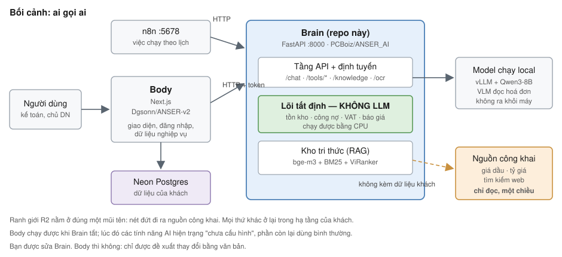
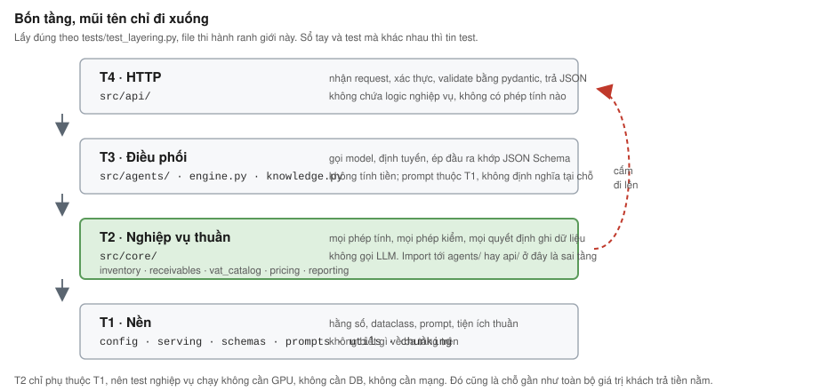
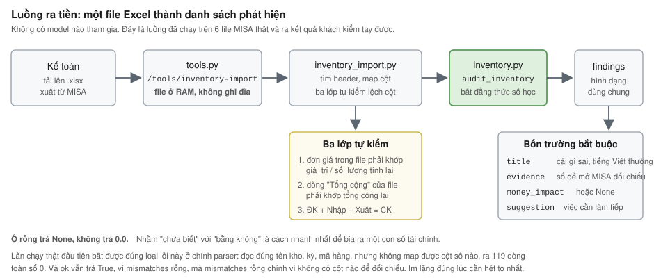
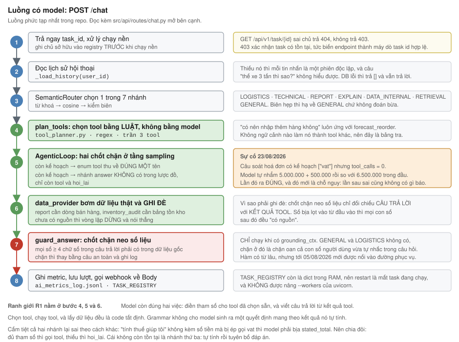

# ANSER Brain — Sổ tay cho người mới

**Cập nhật 22/10/2026.** Mốc mã nguồn: nhánh `feat/workflow-format-and-deterministic-core`, commit `c81554f`.

Sổ tay này viết cho người chưa biết gì về dự án. Đọc hết mục 1 và 2 là chạy được hệ thống trên máy mình. Đọc tới mục 4 là hiểu một yêu cầu đi qua những đâu. Mục 9 là danh sách việc không được làm, mỗi dòng kèm sự cố đã xảy ra.

Bạn không cần GPU, không cần tài khoản cloud, không cần dữ liệu của khách để bắt đầu. Khoảng 20 phút là có một Brain chạy trên localhost.

Bản in: [`docs/ban-in/SO_TAY_NGUOI_MOI.pdf`](docs/ban-in/SO_TAY_NGUOI_MOI.pdf), 27 trang. Sửa file `.md` này rồi chạy `powershell -File docs/dung-ban-in.ps1` để dựng lại bản PDF trong cùng PR.

> **Quy ước của sổ tay này.** Mỗi khẳng định đi kèm bằng chứng kiểm được và giới hạn của nó. "1003 test xanh" nói rằng mã làm đúng thứ chúng ta định làm; nó không nói cách hiểu nghiệp vụ của chúng ta là đúng. Chỗ nào chưa chắc thì sổ tay ghi là chưa chắc. Nếu bạn thấy một câu không có cách nào kiểm lại, coi đó là lỗi của sổ tay và sửa nó.

---

## Mục lục

1. [Dự án này là gì, trong hai phút](#1-dự-án-này-là-gì-trong-hai-phút)
2. [Cài đặt và chạy trên máy bạn](#2-cài-đặt-và-chạy-trên-máy-bạn)
3. [Code tổ chức thế nào](#3-code-tổ-chức-thế-nào)
4. [Đi theo hai yêu cầu thật](#4-đi-theo-hai-yêu-cầu-thật)
5. [Công thức cho việc hay gặp](#5-công-thức-cho-việc-hay-gặp)
6. [Dữ liệu: đã có gì, còn cần xin gì](#6-dữ-liệu-đã-có-gì-còn-cần-xin-gì)
7. [Nghiệp vụ của khách hàng](#7-nghiệp-vụ-của-khách-hàng)
8. [Từ điển thuật ngữ](#8-từ-điển-thuật-ngữ)
9. [Những điều không bao giờ làm](#9-những-điều-không-bao-giờ-làm)
10. [Đọc gì tiếp, và năm bài tập](#10-đọc-gì-tiếp-và-năm-bài-tập)

---

## 1. Dự án này là gì, trong hai phút

### 1.1. Khách hàng, và một ngày của họ

Khách thí điểm là Công ty TNHH Thương mại Dịch vụ Đầu tư Hoàng Phát, mã số thuế 0109527605. Phân phối dầu nhớt ở Hà Nội, 3 đến 5 người. Họ thuê **MISA** làm kế toán và xuất hoá đơn.

Những gì họ làm bằng tay mỗi ngày:

- Nhập liệu vào MISA, rồi tự tính toán bên ngoài MISA trước khi nhập.
- Theo dõi ai còn nợ, nợ bao lâu, bằng cách mở từng sổ ra xem.
- Đối chiếu tồn kho với hoá đơn thực tế.
- Khi có chuyến hàng: hỏi giá nhà xe, cộng biên, báo giá lại cho khách.

Chủ doanh nghiệp làm việc của ba bốn người cùng lúc, và khi đang lái xe thì không xử lý được gì.

### 1.2. Brain làm gì, Body làm gì

Hệ thống có hai nửa, hai repo, hai ngôn ngữ.

| | **Brain** (repo này) | **Body** |
|---|---|---|
| Repo | `PCBoiz/ANSER_AI` | `Dgsonn/ANSER-v2` |
| Công nghệ | Python, FastAPI | Next.js, Neon Postgres, Drizzle |
| Việc | Cung cấp năng lực AI qua HTTP: soi sổ sách, đọc hoá đơn, chat, sinh workflow | Giao diện, đăng nhập, dữ liệu nghiệp vụ, gọi Brain qua `brain.ts` |
| Quyền của bạn | Sửa thoải mái | **Không sửa.** Chỉ được đề xuất bằng văn bản |

Body chạy được khi Brain tắt. Lúc đó các tính năng AI hiện trạng "chưa cấu hình", phần còn lại vẫn dùng bình thường. Thiết kế như vậy có chủ đích: Brain đổi hạ tầng mà Body không sửa dòng nào.

Một nửa thứ ba nằm ngoài cả hai: **n8n** chạy các việc theo lịch, như gửi báo cáo email và cảnh báo tồn kho thấp. Brain sinh ra JSON workflow cho n8n, và n8n gọi ngược vào `/tools/*` của Brain khi cần tính toán.



### 1.3. Năm ràng buộc, viết tắt R1 đến R5

Đây là phần quan trọng nhất của mục 1. Một đề xuất vi phạm bất kỳ ràng buộc nào thì đề xuất đó sai, kể cả khi nó chạy được. Bản đầy đủ nằm ở [AGENTS.md](AGENTS.md).

| | Tên | Nội dung | Kiểm nhanh |
|---|---|---|---|
| **R1** | Tất định trước | LLM không bao giờ tính toán. Nó đọc tiếng Việt thành cấu trúc, và diễn giải cấu trúc thành tiếng Việt. Mọi phép tính nằm trong Python kiểm thử được | Nếu model đọc sai một chữ số, có bản ghi sổ sách nào sai theo không? |
| **R2** | Chủ quyền dữ liệu | Không gửi dữ liệu khách tới LLM bên thứ ba. Ngoại lệ duy nhất là nguồn công khai một chiều, không kèm tham số chứa dữ liệu khách | Payload này có gì của khách, và nó đi tới đâu? |
| **R3** | Ngân sách là ràng buộc thiết kế | Hạ tầng cho pilot miễn phí tối đa 5.000.000đ/tháng. Mục tiêu hiện tại là bậc T0, khoảng 750.000đ/tháng | Việc này làm tăng bao nhiêu VNĐ/tháng? |
| **R4** | Một nguồn sự thật | Một khái niệm định nghĩa đúng một chỗ. Một định dạng workflow, một lược đồ DB, một bộ prompt | Định nghĩa này đã tồn tại ở chỗ khác chưa? |
| **R5** | Không gắn với phần cứng | Không hardcode tên GPU, số VRAM, đường dẫn máy ai. Mọi tham số phần cứng đọc từ biến môi trường, có mặc định an toàn | Chuyển sang máy khác có phải sửa dòng code nào không? |

R1 có một hệ quả dễ bỏ qua: **"chưa biết" khác "bằng 0"**. `None` nghĩa là chưa biết, `0` nghĩa là biết và bằng không. Gộp hai thứ này tạo ra báo cáo sai mà đọc rất xuôi. Ví dụ thật trong dự án: báo cáo lãi lỗ coi mọi mặt hàng chưa nhập giá vốn là lãi 100%. `reporting.py` vì vậy tính thêm `cogs_coverage_pct`, hạ `confidence` và cảnh báo, chứ không điền 0.

---

## 2. Cài đặt và chạy trên máy bạn

> ### Trước khi đọc mục này: hệ thống chạy thật ở đâu
>
> **Tính đến 24/10/2026, chưa ở đâu cả.** Không có môi trường nào khách truy cập được. [ROADMAP.md](ROADMAP.md) ghi ô *"Đưa lên chỗ khách truy cập được"* là ❌ chưa, và đó là ô đỏ duy nhất còn lại của Giai đoạn B.
>
> Nghĩa là toàn bộ mục 2 này hướng dẫn dựng **môi trường phát triển**, và hiện nó cũng là môi trường duy nhất tồn tại. Đừng đọc nó như mô tả cách sản phẩm vận hành.
>
> Đây không phải chi tiết nhỏ. Sáu phép kiểm sổ sách đã tìm ra 5.596.500đ giá vốn không ghi và 157/160 mã sai diện thuế trên dữ liệu thật của khách, mà khách **chưa có đường nào tự chạy chúng**.
>
> Một điều đáng biết khi tới lúc làm: lớp sinh ra giá trị **không cần GPU và không cần model**. Chạy `RUNTIME_PROFILE=minimal` thì Brain phục vụ toàn bộ `/tools/*` trên một máy CPU rẻ tiền, còn nhánh `/chat` tắt theo thiết kế. Kiểm ngày 24/10: `/health` trả `engine_ready: false` mà `/tools/inventory-audit` vẫn ra 2 phát hiện kèm `money_impact`.
>
> Ô đỏ này **chưa nằm trong chu kỳ đang chạy**. Chu kỳ 01 dồn vào S2, tức đưa `/chat` qua vLLM server chạy Qwen3-8B trên GPU L4. Lý do hoãn và trạng thái: [SRS_CHU_KY_01.md §9](SRS_CHU_KY_01.md).

### 2.1. Cần gì

| Thứ | Phiên bản | Ghi chú |
|---|---|---|
| Python | 3.10 trở lên | CI chạy 3.11; máy dev hiện tại chạy 3.14.4, suite vẫn xanh |
| Git | bất kỳ | |
| GPU | **không cần** | Toàn bộ lớp tất định và tầng API chạy bằng CPU. Xem 2.4 về `ENV=LOCAL` |
| Postgres | không cần | Thiếu `DATABASE_URL` thì Brain lùi về SQLite trong RAM |

Trên Windows, Python từ Microsoft Store thường để lại một `python.exe` giả trong PATH, chạy nó chỉ mở Store. Tìm interpreter thật:

```bash
cmd //c "where python"
```

Trên máy dev hiện tại, bản thật nằm ở `C:\Users\sonkh\AppData\Local\Python\bin\python.exe`.

### 2.2. Lấy mã nguồn

```bash
git clone https://github.com/PCBoiz/ANSER_AI.git
cd ANSER_AI
git checkout feat/workflow-format-and-deterministic-core
```

Nhánh `main` là bản **trước khi có lõi tất định**. Đừng làm việc trên đó, và đừng gộp nhánh làm việc vào nó. Nhánh `test` là nhánh rác.

### 2.3. Môi trường ảo và thư viện

```bash
python -m venv .venv
# Windows (Git Bash)
source .venv/Scripts/activate
# Linux / macOS
source .venv/bin/activate
```

Cài theo **mức nhẹ** trước. Đây là đúng danh sách mà tầng API và tầng tất định import, lấy từ `.github/workflows/ci.yml`:

```bash
pip install --upgrade pip
pip install -r requirements-dev.txt
pip install fastapi httpx pydantic numpy json_repair sqlalchemy requests ddgs python-multipart openpyxl
```

Mức nhẹ chạy được toàn bộ 1003 test và toàn bộ `/tools/*`. Bằng chứng: CI dùng đúng hai lệnh trên và suite xanh.

`requirements.txt` đầy đủ kéo theo `torch`, `vllm`, `chromadb`, `sentence-transformers`. Khoảng vài GB, và chỉ cần khi bạn nạp model thật hoặc chạy kho tri thức. Cài khi nào cần:

```bash
pip install -r requirements.txt
```

Ba thư viện dễ bị quên và hậu quả của chúng:

| Thiếu gói | Triệu chứng |
|---|---|
| `openpyxl` | Ba endpoint nạp `.xlsx` trả 500 ngay lần gọi đầu. Trước 23/08/2026 nó không có trong requirements nào, chạy được vì Colab cài sẵn, và 34 test của chính ba đường đó `importorskip` rồi nằm im |
| `jsonschema` | 3 test kiểm grammar của vòng agentic chuyển sang SKIP. Nhãn xanh không nói gì về chốt chặn quan trọng nhất |
| `pytest-asyncio` | `test_chat_background_task` FAIL im lặng, không phải skip |

Cả ba nay nằm trong `requirements-dev.txt` hoặc `requirements.txt`. Nêu ra để bạn biết loại lỗi này trông như thế nào.

### 2.4. Biến môi trường

Không có biến nào là bắt buộc. Mặc định được chọn để chạy được ngay trên máy trống.

| Biến | Mặc định | Làm gì |
|---|---|---|
| `ENV` | `LOCAL` | `LOCAL` trả mock thay vì nạp model thật. Mọi giá trị khác đi vào nhánh nạp model lên GPU |
| `API_AUTH_TOKEN` | rỗng | Token Body phải gửi kèm. **Rỗng nghĩa là tắt kiểm tra.** `GET /health` khai trạng thái này ở trường `auth_enabled` |
| `DATABASE_URL` | SQLite trong RAM | DB của Body. Thiếu thì mọi câu tra cứu hàng hoá trả "không tìm thấy" |
| `TEXT_MODEL_ID` | xem cảnh báo dưới | Đường dẫn hoặc HuggingFace id của model text |
| `VISION_MODEL_ID` | `Qwen/Qwen2.5-VL-3B-Instruct` | Model đọc ảnh hoá đơn |
| `TEXT_MAX_MODEL_LEN` | `8192` | Cửa sổ ngữ cảnh. Dùng chung tên với `docker-compose.yml` theo R4 |
| `KB_WORKSPACE_ID` | `default` | Phạm vi kho tri thức. Phải khớp `BRAIN_KB_WORKSPACE` bên Body |
| `VLLM_BASE_URL` | rỗng | Địa chỉ vLLM chạy chế độ server. Xem mục 10 về trạng thái thật của biến này |
| `AI_METRICS_PATH` | `src/data/ai_metrics_log.jsonl` | Nơi ghi nhật ký đo lường từng lượt |
| `AI_METRICS_LOG_CONTENT` | `0` | `1` thì ghi cả nội dung tin nhắn. Biên lợi nhuận và secret luôn bị che |
| `ALLOWED_ORIGINS` | `http://localhost:3000` | CORS |

> **Cảnh báo về `TEXT_MODEL_ID`.** Mặc định trong [`config.py:55`](src/core/config.py#L55) hiện là `/content/drive/MyDrive/ANSER_data/anser-retail-v2-awq`. Đường dẫn Google Drive trong code vi phạm R5, và `anser-retail-v2` là model đã nghỉ hưu từ 27/07/2026. Nếu bạn chạy với `ENV` khác `LOCAL` mà không đặt biến này, việc nạp model sẽ thất bại. Việc sửa nằm ở [GIAO_VIEC_BRAIN.md](GIAO_VIEC_BRAIN.md) mục V1. Model nền đúng theo quyết định hiện hành là `Qwen/Qwen3-8B`.

Đặt biến cho một phiên làm việc:

```bash
export ENV=LOCAL                 # Git Bash / Linux
$env:ENV = "LOCAL"               # PowerShell
```

Repo không có file `.env` cho máy dev. Mẫu cho triển khai docker nằm ở `deploy/.env.example`. Đừng commit `.env` thật.

### 2.5. Chạy test trước khi chạy server

Làm bước này trước. Nó mất gần hai phút và cho bạn biết môi trường đã đủ chưa.

```bash
ENV=LOCAL pytest -q
```

Kết quả đúng, đo ngày 22/10/2026:

```
1003 passed, 1 warning in 107.27s
```

Một warning về symlink của HuggingFace trên Windows, vô hại.

`pythonpath` và `testpaths` đã khai trong `pyproject.toml`, nên bạn chạy từ thư mục gốc là được, không cần `PYTHONPATH`.

Chạy một file riêng khi đang sửa một chỗ:

```bash
ENV=LOCAL pytest tests/test_deterministic_core.py -q
ENV=LOCAL pytest tests/test_tool_planner.py -q -k hoa_don
```

Hai cổng chất lượng còn lại, giống CI:

```bash
ruff check src/core/memory.py src/core/context.py tests
mypy src/core/memory.py src/core/context.py
```

### 2.6. Bật server

```bash
ENV=LOCAL uvicorn src.api.main:app --host 127.0.0.1 --port 8000 --reload
```

> `src/README.md` ghi `uvicorn src.server:app`. File `src/server.py` đã bị tách thành `src/api/` từ lâu, nên lệnh trong README đó **gãy**. Dùng lệnh trên.

Kiểm sống:

```bash
curl -s http://127.0.0.1:8000/health | python -m json.tool
```

Những trường cần nhìn:

| Trường | Ý nghĩa |
|---|---|
| `status` | `ok` nếu app dựng được |
| `auth_enabled` | `false` khi `API_AUTH_TOKEN` rỗng. Trước khi mở ra Internet, trường này **phải** là `true` |
| `degraded` | `true` nếu engine, kho tri thức hoặc vision lỗi |
| `engine_error`, `kb_error`, `vision_error` | nội dung lỗi cụ thể, hoặc `null` |
| `load` | thống kê điều tiết tải: `peak_queued` và `rejected_total` là hai số quyết định nên nâng hay hạ `max_concurrent` |

`/health` là endpoint duy nhất không đòi token. Nó phải trả lời được cả khi người hỏi chưa có token, vì đó là chỗ để biết Brain sống hay chết.

### 2.7. Gọi thử ba endpoint

**Danh mục tool.** Trả JSON Schema của từng tool, dùng chung cho vòng agentic, lớp MCP và n8n:

```bash
curl -s http://127.0.0.1:8000/tools | python -m json.tool | head -40
```

**Soi một dòng tồn kho có lỗi.** Dòng dưới tái tạo đúng ca `VT00059` trong sổ thật của khách: đầu kỳ 87, nhập 4.400, xuất 4.508, nên tồn cuối âm 21 lít.

```bash
curl -s -X POST http://127.0.0.1:8000/tools/inventory-audit \
  -H "Content-Type: application/json" \
  -d '{
    "warehouse": "HÀNG HÓA",
    "period_start": "2026-01-01",
    "period_end": "2026-07-24",
    "lines": [{
      "code": "VT00059", "name": "Dầu thuỷ lực AW46", "unit": "lít",
      "opening_qty": 87, "opening_value": 4300000,
      "in_qty": 4400, "in_value": 228000000,
      "out_qty": 4508, "out_value": 231000000,
      "closing_qty": -21, "closing_value": -1218356
    }]
  }' | python -m json.tool
```

Bạn sẽ nhận về một danh sách `findings`. Mỗi phát hiện có `title` viết bằng tiếng Việt thường, `evidence` là các con số để mở MISA đối chiếu tay, `money_impact` quy ra tiền hoặc `null` khi thành thật là không quy được, và `suggestion` là việc cần làm tiếp. Hình dạng này do [`findings.py`](src/core/findings.py) quy định, và Body chỉ cần một component để hiện mọi loại phát hiện.

**Tính lại VAT một hoá đơn:**

```bash
curl -s -X POST http://127.0.0.1:8000/tools/vat \
  -H "Content-Type: application/json" \
  -d '{"items": [{"name": "Dầu nhớt", "qty": 10, "unit_price": 500000}], "vat_rate": 8, "stated_total": 5400000}' \
  | python -m json.tool
```

Nếu bạn đã đặt `API_AUTH_TOKEN`, thêm header vào mọi lệnh trên:

```bash
-H "X-API-Token: $API_AUTH_TOKEN"
```

Không có token thì nhận 401, không phải 422. Thứ tự đó do `auth_guard` gắn ở tầng router, chạy trước khi FastAPI validate thân request. Nếu bạn thấy 422 kèm tên từng trường khi chưa xác thực, đó là lỗi bảo mật đã từng xảy ra và đã vá ngày 15/08/2026.

### 2.8. Dựng dữ liệu mẫu có lỗi gieo sẵn

Không cần dữ liệu khách để thử bộ soi sổ sách.

```bash
python sample_data/make_sample_data.py
```

Ra `sample_data/ton_kho_mau.xlsx`: 11 mã dầu nhờn, kỳ 01/01 đến 30/06/2026, trong đó 7 mã có lỗi gieo sẵn. Đây là đề bài có đáp án. Bộ soi phải tìm đúng 7 mã đó và không gắn cờ mã nào khác.

| Mã | Lỗi gieo |
|---|---|
| `DN-TL-200` | tồn kho âm |
| `KM-4T-08` | có số lượng nhưng không ghi nhận giá trị |
| `DN-BR-18` | sổ không cân đối, đầu kỳ cộng nhập trừ xuất khác cuối kỳ |
| `LC-COOL-200` | tồn đủ bán khoảng 7 năm |
| `DN-CAT-20` | không xuất đơn vị nào suốt kỳ |
| `DN-GL5-18` | giá vốn hàng tồn cao hơn hàng đã bán |
| `MO-EP2-15` | giá nhập tăng 20% |

Đối chiếu tự động:

```bash
ENV=LOCAL pytest tests/test_sample_data.py -q
```

Hoặc nạp qua HTTP như Body sẽ làm:

```bash
curl -s -X POST http://127.0.0.1:8000/tools/inventory-import \
  -F "file=@sample_data/ton_kho_mau.xlsx" | python -m json.tool
```

### 2.9. Bảng gỡ lỗi

| Triệu chứng | Nguyên nhân | Cách xử lý |
|---|---|---|
| `python` mở Microsoft Store | PATH trỏ vào bản giả của Store | Dùng đường dẫn interpreter thật, xem 2.1 |
| `uvicorn: command not found` | chưa activate venv | `source .venv/Scripts/activate` |
| `ModuleNotFoundError: src` | chạy từ thư mục con | Chạy từ gốc repo. `pyproject.toml` đã khai `pythonpath = ["."]` |
| `/chat` trả 503 `Text runtime unavailable` | `ENV` khác `LOCAL` mà không có model | Đặt `ENV=LOCAL`, hoặc đặt `TEXT_MODEL_ID` hợp lệ |
| Lệnh `uvicorn src.server:app` lỗi | `src/README.md` đã cũ | Dùng `src.api.main:app` |
| Ba endpoint `.xlsx` trả 500 | thiếu `openpyxl` | `pip install openpyxl` |
| Phần tài liệu trả 503, `kb_error` có nội dung | thiếu thư viện RAG | `pip install chromadb sentence-transformers rank_bm25 underthesea` |
| Tra cứu hàng hoá trả "không tìm thấy" dù có hàng | thiếu `DATABASE_URL`, Brain đang chạy SQLite rỗng | Đặt `DATABASE_URL`, hoặc coi đây là hành vi mong đợi trên máy dev |
| "Lỗi hệ thống khi tìm sản phẩm" | `SCHEMA MAP` của [`saas_api.py`](src/core/saas_api.py#L22) lệch tên bảng và cột của Body, 4 trên 8 định danh | Lỗi đã biết, xem mục 10. Ghi vào loại "sai cấu hình", đừng điều tra như lỗi model |
| Nạp 30 tài liệu, giao diện hiện đủ 30, chat vẫn nói chưa có tài liệu | `KB_WORKSPACE_ID` bên Brain lệch `BRAIN_KB_WORKSPACE` bên Body | Để trống cả hai là an toàn nhất, cả hai cùng mặc định `default`. Brain ghi log cảnh báo gọi đích danh hai biến này |
| Vài test SKIP lặng lẽ | thiếu `jsonschema` hoặc `openpyxl` | Cài đủ `requirements-dev.txt`. SKIP trên nhãn xanh không nói gì về chốt chặn |

---

## 3. Code tổ chức thế nào

### 3.1. Bản đồ thư mục

Chỉ những chỗ bạn sẽ đụng.

```
src/
├── api/
│   ├── main.py            # dựng app, CORS, /health, gắn auth_guard cho mọi router
│   ├── dependencies.py    # RuntimeState: nạp model lười + khoá async, auth, clean_output
│   └── routes/
│       ├── chat.py        # POST /chat, GET /api/v1/task/{id} — vòng agentic + 7 nhánh router
│       ├── tools.py       # /tools/* tất định + manifest + lớp MCP bọc REST
│       ├── documents.py   # POST /upload, /ocr, /ocr/freight
│       └── knowledge.py   # /knowledge/documents, /knowledge/search
├── agents/                # LỚP MỎNG quanh model, không chứa logic nghiệp vụ
│   ├── manager.py         # SemanticRouter 3 lớp + ManagerAgent (mỗi nhánh một prompt)
│   ├── agentic.py         # vòng suy nghĩ → gọi tool → quan sát, kèm JSON Schema quyết định
│   ├── coder.py           # sinh JSON workflow n8n
│   ├── vision.py          # đọc ảnh
│   └── base.py            # proxy sang ModelEngine
├── core/                  # LỖI TẤT ĐỊNH — phần lớn giá trị của sản phẩm nằm ở đây
│   ├── inventory.py       # soi sổ tồn kho, 779 dòng
│   ├── inventory_import.py# đọc .xlsx MISA, 3 lớp tự kiểm lệch cột
│   ├── reporting.py       # doanh thu, chi phí, lãi lỗ theo kỳ
│   ├── receivables.py     # công nợ
│   ├── vat_catalog.py     # đối chiếu thuế suất danh mục theo NĐ 174/2025
│   ├── period_diff.py     # so hai bản xuất, tìm chứng từ sửa hồi tố
│   ├── tax_id.py          # kiểm mã số thuế bằng chữ số kiểm tra
│   ├── pricing.py         # tính giá báo khách vận tải
│   ├── carrier_selection.py # xếp hạng nhà xe, 6 tiêu chí có trọng số
│   ├── calibration.py     # chạy lại công thức giá trên báo giá lịch sử, đo MAPE
│   ├── freight_invoice.py # đối chiếu hoá đơn nhà xe
│   ├── forecasting.py     # dự báo đặt hàng lại, Croston/SBA
│   ├── mcp_server.py      # tính VAT, tính lại tổng hoá đơn
│   ├── findings.py        # hình dạng chung của một phát hiện
│   ├── grounding.py       # chặn model bịa số
│   ├── tool_planner.py    # bảng luật chọn tool, bằng regex
│   ├── prompts.py         # NGUỒN DUY NHẤT cho mọi system prompt
│   ├── workflow_schema.py # nguồn duy nhất cho định dạng workflow n8n
│   ├── knowledge.py       # RAG: Chroma + BM25 + rerank, 571 dòng
│   ├── engine.py          # ModelEngine singleton, TaskRegistry
│   ├── serving.py         # điều tiết tải + client gọi vLLM chế độ server
│   ├── config.py          # model id, tham số vLLM, DB url
│   ├── saas_api.py        # truy vấn products/sales của Body
│   ├── memory.py          # lịch sử hội thoại, đọc DB của Body
│   └── metrics.py         # ghi nhật ký từng lượt vào ai_metrics_log.jsonl
├── data/
│   ├── docs/              # 43MB tài liệu luật thuế và báo cáo ngành, nguồn RAG
│   └── blueprints/        # 6 workflow mẫu định dạng Make.com, KHÔNG dùng để train
offline_training/          # sinh dữ liệu, train, lượng tử hoá, benchmark
tests/                     # 43 file, 1003 test
data/n8n_templates/        # 32 workflow n8n thật, trích từ Body
data/sheet_templates/      # mẫu Google Sheet cho pilot vận tải
sample_data/               # bộ dữ liệu có lỗi gieo sẵn
deploy/                    # Dockerfile, docker-compose.yml, .env.example
```

### 3.2. Bốn tầng, mũi tên chỉ đi xuống

Bốn tầng dưới đây lấy đúng theo [`tests/test_layering.py`](tests/test_layering.py), file thi hành ranh giới này. Nếu bạn thấy sổ tay và test mô tả khác nhau, tin test.



| Tầng | Được làm gì | Không được làm gì |
|---|---|---|
| T4 API | Đọc request, xác thực, validate bằng pydantic, gọi xuống, trả JSON | Chứa logic nghiệp vụ hoặc phép tính |
| T3 Điều phối | Gọi model, chọn prompt theo nhánh, ép đầu ra khớp JSON Schema, chạy vòng agentic | Tính tiền. Định nghĩa prompt tại chỗ, prompt thuộc T1 |
| T2 Nghiệp vụ | Mọi phép tính, mọi phép kiểm, mọi quyết định ghi dữ liệu | Gọi LLM. Một dòng `import` tới `agents/` hoặc `api/` ở đây là sai tầng |
| T1 Nền | Hằng số, dataclass, prompt, tiện ích thuần | Biết gì về ba tầng trên |

T2 chỉ phụ thuộc T1, nên test nghiệp vụ chạy không cần GPU, không cần DB, không cần mạng. Đó cũng là chỗ gần như toàn bộ giá trị khách trả tiền nằm.

> `agents/agentic.py` từng import ngược lên `api/routes/chat.py` chỉ để dùng một hàm đếm ngoặc trên chuỗi. Import đặt trong **thân hàm** nên né được vòng lặp import lúc nạp module, và không có gì báo. Nó sống ở đó cho tới khi có người đối chiếu sơ đồ vẽ tay với bản đồ phụ thuộc sinh tự động, ngày 03/08/2026. Lúc đó `ARCHITECTURE_DIAGRAMS.md` vẫn đang ghi "mũi tên chỉ đi xuống", một khẳng định sai. `test_layering.py` biến câu đó thành thứ kiểm được.

### 3.3. Bốn cặp file phải khớp nhau

R4 nói một khái niệm định nghĩa một chỗ. Khi một khái niệm buộc phải xuất hiện ở nhiều nơi, các nơi đó phải dẫn xuất từ một nguồn. Bốn nhóm dưới đây đã từng lệch, và mỗi lần lệch đều tốn một vòng đo hoặc một lỗ bảo mật.

| Khái niệm | Các nơi phải khớp | Lệch thì sao |
|---|---|---|
| Định dạng workflow n8n | [`workflow_schema.py`](src/core/workflow_schema.py) là nguồn; `prompts.py::CODER_SYSTEM` dạy model; `chat.py::_validate_workflow` kiểm | Model từng được train trên Make.com, prompt bằng ví dụ n8n, đưa danh mục node của Body, rồi validate theo luật n8n. Bốn nguồn, ba định dạng |
| Trường hệ thống tự bơm | `tool_planner.py::SYSTEM_DATA_FIELDS` là nguồn; `agentic.py::arguments_schema` bỏ chúng khỏi grammar; `render_tools()` không quảng cáo chúng trong prompt | Prompt từng dạy model điền `sales`, trong khi grammar cấm. Model làm đúng lời dặn, viết mảng dài, tràn trần token, JSON cắt cụt, vòng lặp gãy |
| Trần token | `MAX_DECISION_TOKENS`, `MAX_REPORT_TOKENS`, `MAX_WORKFLOW_TOKENS` là hằng số module; `benchmark_v3.py` import thẳng | Benchmark từng đo ở 1024 trong khi production cấp 700. Mọi tỷ lệ cắt cụt đo được đẹp hơn thứ khách nhận |
| Tên biến môi trường | `dependencies.py` đọc `API_AUTH_TOKEN`; `docker-compose.yml` ánh xạ `API_AUTH_TOKEN: ${API_TOKEN}`; `tests/test_deploy_config.py` đọc cả hai file và đối chiếu | Compose từng đặt `API_TOKEN`, code đọc `API_AUTH_TOKEN`, và `require_api_token` bỏ qua mọi kiểm tra khi biến nó đọc rỗng. Brain triển khai theo README không kiểm token nào mà vẫn mở ra Internet |

Lược đồ DB cũng thuộc nhóm này và **hiện đang lệch**: `prompts.py::DB_SCHEMA`, `offline_training/db_schema.txt` và SQL trong `saas_api.py` chưa khớp nhau. Xem mục 10.

---

## 4. Đi theo hai yêu cầu thật

### 4.1. Luồng ra tiền: một file Excel thành danh sách phát hiện

Luồng này không có model nào tham gia. Nó là thứ đã chạy trên 6 file MISA thật và ra kết quả khách kiểm tay được.



**Bước 1, route.** [`tools.py:394`](src/api/routes/tools.py#L394) nhận `multipart/form-data`. File đọc vào bộ nhớ, **không ghi ra đĩa** theo R2. Kích thước kiểm hai lần: `content-length` trước để từ chối sớm, rồi độ dài thật sau, vì header do client gửi và hoàn toàn có thể nói dối.

**Bước 2, parser.** `inventory_import.py` đọc bảng. Chỗ khó nhất là tìm header: MISA đặt nhóm cột (`Đầu kỳ`, `Nhập kho`) **cùng dòng** với `Mã hàng`, còn tên cột con (`Số lượng`, `Giá trị`) ở **dòng kế tiếp**. `_find_header` nhận cả hai cách bố trí.

Ba lớp tự kiểm, không lớp nào tự sửa dữ liệu:

1. Đơn giá bình quân có sẵn trong file phải khớp `giá_trị / số_lượng` tính lại.
2. Dòng "Tổng cộng" của chính file phải khớp tổng cộng lại. File tự tố cáo chính nó.
3. Đầu kỳ cộng nhập trừ xuất phải bằng cuối kỳ, trên từng dòng.

Ô rỗng trả `None`, không trả `0.0`.

> Lần chạy thật đầu tiên bắt được đúng loại lỗi này ở chính parser. Giả định ban đầu về bố trí header sai, nên hệ thống đọc đúng tên kho, kỳ, mã hàng, tên hàng, mà **không map được cột số nào**: ra 119 dòng với mọi con số bằng 0. Và `ok` vẫn trả `True`, vì `mismatches` rỗng, mà `mismatches` rỗng chính *vì* không có cột nào để đối chiếu. Đã sửa cả hai: `_find_header` nhận hai bố trí, và `ok` tính thêm `missing_columns`.

**Bước 3, soi lỗi.** `audit_inventory` chạy các phép kiểm độc lập trên từng dòng: tồn âm, sổ không cân đối, giá trị bằng 0 khi có số lượng, hàng chết, giá vốn hàng tồn cao hơn hàng đã bán, giá nhập nhảy bậc, hai phương pháp tính giá vốn chạy song song. Mỗi phép kiểm là một bất đẳng thức số học, kèm bằng chứng đối chiếu tay được.

**Bước 4, hình dạng đầu ra.** Mọi phép kiểm trả cùng một kiểu dict qua `findings.finding()`. Bốn trường phải có ý nghĩa với người đọc là chủ doanh nghiệp: `title`, `evidence`, `money_impact`, `suggestion`.

> **Một phép kiểm đã bị gỡ vì nó sai.** Bản đầu có kiểm tra "đơn giá tồn cuối cao hơn mọi giá đầu vào suy ra sổ ghi sai giá vốn". Lập luận nghe rất chắc, nhưng dữ liệu đầu vào của nó thì không: `in_value / in_qty` là giá nhập bình quân cả kỳ, không phải giá từng lô. Với FIFO và giá tăng dần, hàng bán ra là lô cũ rẻ còn hàng nằm lại là lô mới đắt, nên đơn giá tồn cuối vượt giá nhập bình quân là kết quả đúng. Chạy trên 119 mã thật, kiểm tra này gắn cờ 18 mã và cả 18 đều vô tội. Khi một quy tắc bắn trên hàng chục mã cùng lúc, nghi quy tắc trước, đừng nghi sổ sách.

### 4.2. Luồng có model: POST /chat

Đây là luồng phức tạp nhất trong repo. Đọc kèm [`chat.py`](src/api/routes/chat.py) mở bên cạnh.



**Bước 1, trả ngay `task_id`.** Endpoint không chờ xử lý xong. Nó ghi chủ sở hữu vào registry **trước** khi chạy nền, rồi trả `task_id`. Body hỏi kết quả qua `GET /api/v1/task/{task_id}` kèm header `X-User-Id`.

Endpoint hỏi kết quả đó trả về câu trả lời đầy đủ, với sản phẩm kế toán nghĩa là tên khách, mã số thuế, số công nợ. Nó kiểm hai thứ: token ở tầng router, và chủ sở hữu trong handler. Sai chủ thì trả **404 chứ không 403**, vì 403 xác nhận task đó có tồn tại, tức là biến endpoint thành máy dò task id hợp lệ.

**Bước 2, lịch sử hội thoại.** `_load_history` đọc các lượt cũ. Thiếu nó thì mỗi tin nhắn là một phiên độc lập, và câu "thế xe 3 tấn thì sao?" không hiểu được. DB lỗi thì trả `[]` và Brain vẫn trả lời, chỉ mất ngữ cảnh.

**Bước 3, định tuyến.** `SemanticRouter` chạy ba lớp: luật từ khoá, rồi cosine trên embedding, rồi kiểm biên. Biên hẹp thì hạ về `GENERAL` chứ không đoán bừa. Bảy nhánh: `LOGISTICS`, `TECHNICAL`, `REPORT`, `EXPLAIN`, `DATA_INTERNAL`, `RETRIEVAL`, `GENERAL`.

Thiếu embedder thì router lùi về lớp từ khoá và **tự khai báo** qua `method="keyword_only_degraded"`.

**Bước 4, chọn tool bằng luật.** `plan_tools` trong [`tool_planner.py`](src/core/tool_planner.py) ánh xạ ý định sang tên tool bằng regex. Câu "có nên nhập thêm hàng không" luôn ứng với `forecast_reorder`; không có ngữ cảnh nào làm nó thành tool khác. Đây là bảng tra, và model không tham gia.

Trần kế hoạch là 3 tool một câu hỏi, vì `DEFAULT_MAX_STEPS` là 4 và bước cuối phải dành cho việc viết câu trả lời.

**Bước 5, vòng agentic.** `AgenticLoop` chạy vòng suy nghĩ, gọi tool, quan sát. Hai chốt chặn ở tầng sampling:

- Còn kế hoạch thì enum `tool` trong JSON Schema thu về **đúng một tên**. Chọn sai tool không còn là thứ model có thể làm.
- Còn kế hoạch thì nhánh `answer` **không có trong lược đồ**, chỉ còn `tool` và `hoi_lai`. Model không có cửa nào để tự tính rồi tuyên bố kết quả.

Vế thứ hai đến từ một sự cố ngày 23/08/2026: câu soát hoá đơn có kế hoạch `["vat"]` nhưng `tool_calls = 0`. Model tự nhẩm `5.000.000 + 500.000` rồi so với `6.500.000` trong đầu. Lần đó ra **đúng**, và đó là chỗ nguy, vì một con số model tự tính thì lần sau sai cũng không có gì báo.

Cấm tiệt cả hai nhánh lại sai theo cách khác: "tính thuế giúp tôi" không kèm số tiền mà bị ép gọi `vat` thì model phải bịa `stated_total`. Như vậy chỉ đổi một lỗi R1 lấy một lỗi R1 khác, và lỗi sau tệ hơn vì con số bịa đi qua tool nên trông như có nguồn. `test_van_hoi_lai_duoc_khi_thieu_tham_so` giữ điều này.

**Bước 6, dữ liệu đầu vào cũng phải tất định.** Quan trọng hơn cả bảng luật. `report` cần dòng bán hàng, `inventory_audit` cần bảng tồn kho, và model không có những thứ đó. `data_provider` bơm dữ liệu từ nguồn thật và **ghi đè**, không hợp nhất. Chưa có nguồn thì vòng lặp dừng và nói thẳng, với câu chữ nói rõ người dùng phải làm gì.

Lý do phải ghi đè: chốt chặn neo số liệu chỉ đối chiếu **câu trả lời** với **kết quả tool**. Nếu số bịa lọt vào từ đầu vào thì mọi con số sau đó đều có nguồn.

**Bước 7, chốt chặn neo số liệu.** `guard_answer` trong [`grounding.py`](src/core/grounding.py) bắt mọi số từ 4 chữ số trở lên trong câu trả lời phải xuất hiện trong dữ liệu gốc. Chặn thì thay bằng câu an toàn và ghi log.

Nó **chỉ** chạy khi có `grounding_ctx`. Nhánh `GENERAL` và `LOGISTICS` không có, và chặn ở đó là chặn oan mọi con số người dùng vừa tự nhắc trong câu hỏi.

Hàm này tồn tại từ lâu và chạy ở hai chỗ, lọc dữ liệu huấn luyện và chấm điểm benchmark. Nó không chạy ở chỗ thứ ba, chỗ lúc phục vụ, cho tới 05/08/2026. Nghĩa là dự án đo được model bịa số 8 đến 10 ca trên 27, rồi vẫn để con số bịa đó đi thẳng ra màn hình chủ doanh nghiệp.

**Bước 8, trả kết quả.** Ghi `TurnMetric` vào `ai_metrics_log.jsonl`, lưu lượt vào lịch sử, gọi webhook về Body nếu có `BODY_CALLBACK_URL`, và ghi vào `TASK_REGISTRY`.

### Tự kiểm

Trả lời được bốn câu này thì bạn đã hiểu luồng:

1. Người dùng hỏi "tháng này lãi bao nhiêu" trong khi Body chưa mở API xuất dòng bán hàng. Brain trả về gì, và con số nào xuất hiện trong câu trả lời?
2. Vì sao `plan_tools` dùng regex thay vì để model chọn tool, khi model chọn đúng tới 26 đến 33%?
3. `guard_answer` không chặn được ca model tự nhẩm `5.000.000 + 500.000`. Vì sao, và chốt chặn nào bắt được ca đó?
4. Một câu dán kèm hoá đơn vận tải, trong đó tên dòng hàng là "Cước vận chuyển HN-HP". Router bắt thành nhánh nào, và vì sao `chat.py` phải có một ngoại lệ hẹp cho nó?

Đáp án câu 4 nằm ở [`chat.py:525-541`](src/api/routes/chat.py#L525-L541). Ba câu còn lại nằm trong mục 4.2 ở trên.

---

## 5. Công thức cho việc hay gặp

### 5.1. Thêm một tool tất định mới

Thứ tự này có chủ đích. Làm ngược là viết xong rồi mới phát hiện mình đã định nghĩa lại một thứ đã có.

1. **Kiểm tra khái niệm đã tồn tại chưa.** `grep -rn "<khái niệm>" src/core/`. R4 là ràng buộc bị vi phạm nhiều nhất trong repo này.
2. **Viết engine thuần trong `src/core/`.** Hàm nhận dataclass, trả dict. Không `import` gì từ `src/agents/` hoặc `src/api/`. Không gọi LLM.
3. **Ô rỗng trả `None`.** Thiếu dữ liệu thì nói thiếu, hạ `confidence`, thêm `warnings`. Đừng điền 0.
4. **Viết unit test trước khi nối vào API.** Logic tất định là phần không được phép sai. Gồm cả ca dữ liệu bẩn và ca thiếu trường.
5. **Thêm pydantic model và endpoint trong `tools.py`.** Tool tự validate đầu vào, không tin tham số model điền. Tool ghi dữ liệu tạo bản ghi `pending_review`, không tự duyệt bất cứ thứ gì chạm tiền.
6. **Thêm vào `_TOOL_DEFS` và `_TOOL_IMPL`.** Một định nghĩa, ba nơi dùng: vòng agentic, lớp MCP, và `GET /tools`. Nếu tool cần dữ liệu hệ thống, thêm tên trường vào `SYSTEM_DATA_FIELDS` của `tool_planner.py`, nếu không model sẽ ngồi viết ra nguyên mảng dữ liệu rồi `data_provider` vứt đi.
7. **Thêm câu chữ "chưa có nguồn" vào `_CHUA_CO_NGUON`** trong `chat.py`, nói rõ người dùng phải làm gì.
8. **Chạy `pytest -q`**, cập nhật tài liệu bị ảnh hưởng trong cùng PR.

### 5.2. Thêm hoặc sửa một luật chọn tool

Bảng luật ở `tool_planner.py` đang đúng 40% trên bộ eval vận tải. Đây là mã tất định: sai thì sửa regex, không train lại model.

Viết luật **chặt** có chủ đích. Luật bắt hụt thì câu đó đi tiếp vào nhánh cũ và vẫn trả lời được. Luật bắt thừa thì một câu chào hỏi bị kéo vào vòng gọi tool và trả về thứ chẳng liên quan. Sai kiểu thứ hai đắt hơn nhiều.

Ba cái bẫy đã ghi trong mã:

- "doanh thu" trần không được kéo vào `report`, vì "hộ kinh doanh doanh thu bao nhiêu thì phải đóng thuế" là câu hỏi luật.
- "công nợ" trần không được kéo vào `partner_audit`, vì "chính sách công nợ bên mình thế nào" là câu tra tài liệu nội bộ. Kéo vào thì câu trả lời đúng bị thay bằng một câu từ chối.
- Số 4 chữ số không được tính là số tiền, vì đó là năm. "Báo cáo thuế năm 2026" mà tính 2026 thành số tiền thì bị kéo vào tool `vat` với tham số vô nghĩa.

Sửa xong thì thêm ca vào `tests/test_tool_planner.py`, gồm cả ca **không được** khớp.

### 5.3. Đổi định dạng workflow n8n

Sửa một nơi mà không sửa hai nơi kia là lỗi. Ba nơi:

| Nơi | Vai trò |
|---|---|
| [`workflow_schema.py`](src/core/workflow_schema.py) | Nguồn sự thật. Prompt, JSON Schema và validator cùng dẫn xuất từ đây |
| `prompts.py::CODER_SYSTEM` | Dạy model định dạng |
| `chat.py::_validate_workflow` | Kiểm đầu ra, trỏ thẳng vào `workflow_schema.validate_workflow` |

Catalog node rút ra từ 32 workflow n8n **thật** của Body, nằm ở `data/n8n_templates/`, qua biến `N8N_TEMPLATES_DIR`. Chưa có thì dùng catalog dự phòng và ghi log cảnh báo.

Hai quy tắc về few-shot: ví dụ phải khử về đúng hình dạng schema sinh, bỏ `id` và `retryOnFail`, vì dạy model field mà grammar cấm là tự phá chất lượng sinh. Và node `code` trong ví dụ thay bằng `noOp`, vì AI sinh workflow không được dùng `code`, JS tuỳ ý vượt mọi luật an toàn. Người viết tay thì được.

### 5.4. Nạp tài liệu vào kho tri thức

```bash
curl -s -X POST http://127.0.0.1:8000/knowledge/documents \
  -H "X-API-Token: $API_AUTH_TOKEN" \
  -F "file=@hop_dong.docx"

curl -s -X POST http://127.0.0.1:8000/knowledge/search \
  -H "X-API-Token: $API_AUTH_TOKEN" \
  -H "Content-Type: application/json" \
  -d '{"query": "chính sách công nợ", "top_k": 3}'
```

Nhúng bằng `BAAI/bge-m3`, xếp lại bằng `namdp-ptit/ViRanker`, tách từ tiếng Việt bằng `underthesea`, lai dense với BM25. Cả hai model chọn vì giấy phép dùng thương mại được, MIT và Apache-2.0.

Kiểm hai hành vi khác nhau trên cùng tình huống "không tìm thấy":

| Câu hỏi | Hành vi đúng |
|---|---|
| "chính sách công nợ bên mình thế nào" khi chưa nạp gì | Nói chưa có tài liệu. **Không** tra web |
| "nghị định 72 quy định thuế suất bao nhiêu" | Được phép tra web |

Trả một bài viết trên mạng cho câu đầu là trình bày thông tin của công ty khác như thể là quy định của họ. Dấu hiệu nội bộ **thắng** dấu hiệu luật, do [`retrieval_policy.py`](src/core/retrieval_policy.py) quyết định. Câu thú nhận không biết là hằng số, không nhờ model diễn đạt, để nó khỏi biến thành một câu nghe như đang biết.

### 5.5. Chạy phiên đo trên Colab

Runbook đầy đủ ở [PHIEN_DO_COLAB.md](PHIEN_DO_COLAB.md). Cần GPU L4 hoặc A100; T4 16GB không đủ cho Qwen3-8B AWQ. Khoảng một giờ khi đo lại, vì dữ liệu sinh phiên 15/08 còn trên Drive.

Notebook đã có ở `offline_training/ANSER_train_v3_colab.ipynb`. Chỉ thị của chủ dự án: **không tự tạo notebook mới**.

Trước khi đọc điểm số, đọc ba dòng cảnh báo khung đo:

```
⚠ ... đầu ra KHÔNG đọc được thành JSON
⚠ ... CẮT CỤT
[chốt chặn] ràng buộc JSON: ✓ CHẠY
```

Tỷ lệ JSON hỏng từ 30% trở lên gần như luôn là mã, không phải model. Ba lần bộ đo cho ra số xấu vì lý do không nằm ở model: bộ chấm đọc sai tên trường, guided decoding im lặng không áp dụng, và `arguments_schema` không đóng object.

### 5.6. Git và sao lưu

| Khi nào | Làm gì |
|---|---|
| Chạm 5 file bị sửa, hoặc trước một thay đổi cấu trúc rủi ro cao | Commit cục bộ |
| Cuối một giai đoạn, sau khi có người phê duyệt | Sao lưu có dấu thời gian vào `_backups/Phase_X_YYYYMMDD/`, bỏ `__pycache__` và `.venv`, rồi commit và push |
| Trước khi push lịch sử lên một remote mới hoặc public | Quét secret trên **toàn bộ** lịch sử, không chỉ HEAD |

Lệnh quét secret:

```bash
git log --all -S 'postgres://' --oneline
git log --all -S 'npg_' --oneline
git log --all -S 'sk-' --oneline
git log --all -S 'hf_' --oneline
```

Push lịch sử nghĩa là publish mọi commit từng tồn tại. Sự cố thật ngày 27/07/2026: 3 script trong `src/archive/` chứa nguyên chuỗi kết nối Neon Postgres, nhân bản thành 12 file qua các bản backup, bị đẩy lên GitHub public. Neon phát cảnh báo, phải xoay mật khẩu.

Credential đã lộ là credential đã chết. Bot quét GitHub trong vài giây, nên xoá khỏi git không thu hồi được nó. Việc đầu tiên luôn là xoay hoặc vô hiệu credential; dọn repo là bước sau.

---

## 6. Dữ liệu: đã có gì, còn cần xin gì

Phần lớn việc đang chặn ở dữ liệu, không chặn ở mã. Bạn nên biết chính xác cái gì đã có.

### 6.1. Đã nhận và đã dùng

| Thứ | Lượng | Đọc được |
|---|---|---|
| Tổng hợp tồn kho đến 24/07/2026 | 119 mã | 119/119, không cảnh báo |
| Tổng hợp tồn kho đến 11/08/2026 | 121 mã | 121/121 |
| Danh sách hàng hoá, dịch vụ | 161 mã | 161/161 |
| Danh sách khách hàng | 104 | 104/104 |
| Danh sách nhà cung cấp | 42 | 42/42 |

Toàn bộ là file `.xlsx` xuất từ MISA. Khách gửi PDF trước, và PDF đó in ra từ Excel, nên xin bản `.xlsx` cho đọc chính xác 100%. OCR một bảng số tiền là tự chuốc rủi ro đọc nhầm 5 thành 6 ở cột giá vốn.

### 6.2. Còn cần xin, theo thứ tự đáng tiền

| Thứ | Mở khoá được gì | Trạng thái |
|---|---|---|
| **Sổ chi tiết công nợ phải thu**, có ngày hoá đơn | Tuổi nợ 30/60/90 ngày. Số dư hiện có không kèm ngày nên chưa biết ai quá hạn | đã xin, chờ |
| Sổ chi tiết 3 mã `VT00039`, `VT00042`, `VT00023` | Truy ra chứng từ nào bị sửa hồi tố | đã xin, chờ |
| Tổng hợp tồn kho **kho KHUYẾN MẠI** đến 11/08 | Kiểm lại `KM00034` âm 115,2 lít | đã xin, chờ |
| 3 đến 5 hoá đơn bán ra sau 01/7/2025 | Thuế suất thực tế đang ghi là 8% hay 10% | đã xin, chờ |
| Doanh thu theo mã hàng | Lãi gộp thật. Hiện chỉ có giá vốn | chưa xin |
| 10 đến 30 tài liệu nội bộ | Kho tri thức có nội dung thật để tra | chưa xin |

Danh sách đầy đủ, kèm cách xin và tên cột cần có: [HOANG_PHAT_DU_LIEU_CAN_XIN.md](HOANG_PHAT_DU_LIEU_CAN_XIN.md). Bản gửi khách: [HOANG_PHAT_GUI_KHACH.md](HOANG_PHAT_GUI_KHACH.md).

Phần vận tải cần thêm 15 đến 20 báo giá đã chốt, 30 đến 50 ca chọn nhà xe, và 30 đến 50 ảnh hoá đơn nhà xe. Những thứ đó thuộc [BAN_GIAO_VAN_TAI.md](BAN_GIAO_VAN_TAI.md).

### 6.3. Dữ liệu nào không bao giờ vào repo

File MISA gốc chứa tên khách, mã số thuế, số nợ. Fixture test dùng số tổng hợp tái tạo đúng các quan hệ số học, làm tròn cho dễ đọc. Đã kiểm là cho kết quả y hệt.

`sample_data/an_danh.py` là công cụ ẩn danh. Dùng nó trước khi đưa bất cứ thứ gì từ sổ khách vào repo.

### 6.4. Dữ liệu nào không bao giờ vào RAG

Giá dầu, số dư công nợ, tồn kho, bảng giá cước còn hiệu lực. Giá dầu đổi chiều thứ Năm hằng tuần theo NĐ 80/2023, khoảng 52 kỳ một năm. Nhúng vào vector DB nghĩa là embedding của giá cũ nằm lại vĩnh viễn và vẫn được truy hồi ra, trả về một con số trông hợp lệ nhưng đã sai.

Ranh giới: **RAG cho văn bản cần tìm kiếm, tool cho con số cần tra cứu.** Hợp đồng, chính sách, nghị định thì vào RAG. Giá cả thì đi đường tra cứu tất định, lấy bản mới nhất tại thời điểm gọi.

---

## 7. Nghiệp vụ của khách hàng

Phân biệt hai mức này trước khi viết mã theo một yêu cầu. Dự án đã từng suýt xây cả một quy trình báo giá cước cho một công ty không làm vận tải.

### 7.1. Đã xác nhận

- Phân phối dầu nhớt, 3 đến 5 người, Hà Nội. Chủ là chú Quyết.
- Ba bậc giá: bán lẻ, đại lý cấp 1, đại lý cấp 2.
- Một kho vật lý. "KHO KHUYẾN MẠI" trong MISA là nhãn sổ sách, không phải kho thứ hai.
- Giá bán **không** có trong bản xuất MISA, vì nó thay đổi theo khách và theo lúc.
- Kế toán nhập giá bằng tay, chủ giám sát. Không có người duyệt cấp cao hơn.
- Ngày 13/08/2026 khách nói rõ: *"hiện tại công ty chú là chuyên bán dầu, chưa phải là công ty về vận tải"*.

### 7.2. Đã nghe nhưng chưa xác nhận

Những thứ này nằm trong `BLOCKERS.md` bên Body, chưa vào mã:

- Bậc đại lý cấp 3, giá cho thương mại điện tử, bán lô thanh lý.
- Biên lợi nhuận tham chiếu giữa các bậc.
- Duyệt giá bởi cấp trên, giá hợp đồng có thời hạn.
- Công nợ bán lẻ khoảng 60 ngày, chiết khấu khi trả tiền ngay, đặt cọc khoảng 50% cho hàng đặt trước.
- Phân quyền theo bộ phận thay cho nhân viên/quản lý/admin.

Trước khi làm một yêu cầu, hỏi: đây là cách họ **đang** làm, hay là cách họ **muốn** làm?

### 7.3. Sáu phát hiện trên sổ thật, và giới hạn của chúng

Chạy trên 6 file MISA thật, không cần GPU, không cần model:

| Phép kiểm | Tìm ra gì |
|---|---|
| Tồn kho | 2 mã âm; 5.596.500đ giá vốn không được ghi |
| Đối chiếu hai kỳ | Chứng từ sửa hồi tố, 108 lít chạy từ `VT00059` sang `VT00039` |
| Thuế suất GTGT | 157/160 mã để sai diện thuế theo NĐ 174/2025 |
| Công nợ | Phải thu 3,96 tỷ, bằng 113 ngày giá vốn; 3 khách giữ 66% |
| Mã số thuế | 114 mã kiểm được, 0 sai, 0 báo oan |
| Hàng chết | 29 mã, khoảng 161 triệu nằm im |

Bộ đo riêng: `offline_training/eval_ke_toan.py`, 12 ca gieo lỗi vào chính sổ thật. Hiện 12/12 bắt được và 12/12 không báo oan.

**Giới hạn, và hãy đọc kỹ phần này.** n = 12 nên khoảng tin cậy là 75,8% đến 100%. "12/12" không phải "100%". Và đáp án của 12 ca do chính chúng ta đặt, nên bộ đo trả lời được *"mã có làm đúng thứ ta định không"*, không trả lời được *"cách hiểu nghiệp vụ của ta có đúng không"*.

Ba chỗ đang tự khẳng định, chưa ai ngoài dự án xác nhận:

| Chỗ | Rủi ro nếu hiểu sai |
|---|---|
| Bảng tra thuế 8% và 10% | Khách xuất hoá đơn sai thuế suất, dẫn tới truy thu và phạt |
| Định nghĩa "sửa hồi tố" | Cáo buộc sổ bị sửa mà thực ra là nghiệp vụ bình thường |
| Ngưỡng tập trung 20% và 50% | Con số do dự án đặt, chưa ai xác nhận là mức đáng lo |

Một kế toán có nghề đọc [HOANG_PHAT_SOAT_SO_1108.md](HOANG_PHAT_SOAT_SO_1108.md) và nói từng phát hiện đúng hay sai sẽ gỡ cả ba. Một buổi là đủ, và đó là việc rẻ nhất đang chặn nhiều thứ nhất.

---

## 8. Từ điển thuật ngữ

### Nghiệp vụ

| Thuật ngữ | Nghĩa |
|---|---|
| **MISA** | Phần mềm kế toán khách đang thuê. Nguồn của mọi file `.xlsx` dự án đọc |
| **Giá vốn** / COGS | Giá mua vào của hàng đã bán. Cột "Xuất kho / Giá trị" trong bảng tổng hợp tồn kho |
| **Lãi gộp** | Doanh thu trừ giá vốn. Thiếu giá vốn mà điền 0 thì lãi gộp bằng doanh thu, một con số sai mà trông rất đẹp |
| **Tồn kho âm** | Đầu kỳ cộng nhập trừ xuất ra số âm. Xuất nhiều hơn số có |
| **Sửa hồi tố** | Chứng từ trong kỳ đã báo cáo bị sửa, xoá hoặc huỷ ghi sổ sau khi báo cáo đã xuất. Nhìn ra được khi so hai bản xuất cùng ngày bắt đầu: số xuất luỹ kế của kỳ dài hơn chỉ có thể tăng hoặc giữ nguyên |
| **Công nợ phải thu** | Tiền khách còn nợ. Phải thu âm nghĩa là khách trả nhiều hơn số nợ ghi nhận |
| **Tuổi nợ** | Nợ chia theo 30/60/90 ngày. Cần ngày hoá đơn, nên hiện chưa tính được |
| **Mua đứt bán đoạn** | Mã nhập rồi bán hết trong kỳ, không còn tồn |
| **Hàng chết** | Mã không xuất đơn vị nào suốt kỳ. Vốn nằm im, không phải lỗi sổ sách |
| **FIFO / bình quân** | Hai phương pháp tính giá vốn. VAS 02 buộc nhất quán, nên chạy song song hai phương pháp trong cùng một kỳ là vấn đề |
| **NĐ 174/2025** | Bỏ "sản phẩm dầu mỏ tinh chế" khỏi danh mục không được giảm thuế, trong đó ghi rõ dầu mỡ bôi trơn. Hiệu lực 01/7/2025 đến 31/12/2026, nên dầu nhớt được giảm còn 8% |
| **NĐ 80/2023** | Giá bán lẻ xăng dầu điều chỉnh chiều thứ Năm hằng tuần |
| **NĐ 158/2024** | Phân loại kinh doanh vận tải hàng hoá đường bộ, và quy định giấy vận tải phải phát cho tài xế trước khi xe chạy |
| **Forwarder** | Nhà môi giới vận tải. Nhận yêu cầu từ chủ hàng, hỏi giá nhà xe, cộng biên, báo lại |

### Kỹ thuật

| Thuật ngữ | Nghĩa |
|---|---|
| **Brain / Body** | Hai nửa của hệ thống. Xem 1.2 |
| **Lõi tất định** | Mã Python thuần, không gọi LLM, kiểm thử được. Nơi mọi phép tính nằm |
| **Guided decoding** / `guided_json` | Ép đầu ra khớp JSON Schema ngay ở tầng sampling. Token nào làm JSON sai schema thì bị loại khỏi phân phối, nên JSON hỏng trở thành bất khả thi về cấu trúc |
| **Grammar** | Tên gọi khác của ràng buộc trên. "Grammar cấm" nghĩa là model không sinh nổi, khác hẳn "prompt dặn đừng làm" |
| **Vòng agentic** | Vòng suy nghĩ, gọi tool, quan sát, lặp lại. Trần 4 bước |
| **`bat_buoc_tool`** | Chế độ bỏ nhánh `answer` khỏi lược đồ khi còn kế hoạch tool, chỉ để lại `tool` và `hoi_lai` |
| **Chốt chặn neo số liệu** | `guard_answer`: mọi số từ 4 chữ số trong câu trả lời phải có trong dữ liệu gốc |
| **vLLM** | Thư viện phục vụ model. `vllm.LLM` là API chạy lô ngoại tuyến; chế độ server mới cho continuous batching |
| **Continuous batching** | Gộp nhiều request vào cùng một vòng lập lịch GPU. Tính năng đắt giá nhất của vLLM |
| **AWQ** | Lượng tử hoá 4-bit. Qwen3-8B AWQ chiếm khoảng 5,5GB VRAM |
| **RAG** | Tra tài liệu rồi đưa đoạn tìm được vào prompt |
| **BM25** | Tìm theo từ khoá. Dùng lai với vector vì mã hàng như `VT00039` là chuỗi chính xác, mà nhúng vector xử lý loại này tệ |
| **Rerank** | Xếp lại các đoạn đã truy hồi bằng một model chấm cặp câu hỏi và đoạn |
| **Recall@20 / MRR** | Hai chỉ số truy hồi. Hiện **chưa đo được cái nào**, xem mục 10 |
| **Faithfulness** | Tỷ lệ khẳng định trong câu trả lời kiểm chứng được từ đoạn đã truy hồi. `grounding.py` đã là một dạng faithfulness thu hẹp về con số |
| **MAPE** | Sai lệch phần trăm trung bình. Dùng để đo công thức giá vận tải so với giá thật. Dưới 10% là dùng được, trên 25% là mô hình sai bản chất |
| **McNemar** | Phép thử so hai model **theo cặp** trên cùng bộ câu hỏi. Nó trả lời "bản mới làm hỏng câu nào mà bản cũ vốn trả lời đúng", thứ mà hai điểm trung bình không trả lời được |
| **Croston / SBA** | Phương pháp dự báo cho nhu cầu rời rạc, dùng trong `forecasting.py` |
| **`pending_review`** | Trạng thái của mọi bản ghi do AI tạo ra mà chạm tiền hoặc sổ sách. Không tự duyệt |
| **T0 đến T3** | Bốn bậc hạ tầng. T0 là GPU thuê bật theo giờ hành chính, khoảng 750.000đ/tháng. T3 là máy tự sở hữu |

---

## 9. Những điều không bao giờ làm

Mỗi dòng kèm lý do. Phần lớn lý do là một sự cố đã xảy ra.

### Dữ liệu và bảo mật

1. **Không gửi dữ liệu khách tới LLM bên thứ ba**, kể cả "chỉ để test". Dữ liệu khách gồm tồn kho, doanh thu, công nợ, bảng giá cước, tỷ lệ biên, danh sách khách, nội dung hoá đơn, lịch sử chat.
2. **Không hardcode credential**, kể cả trong script một lần, kể cả trong `_backups/`. Xem 5.6 về sự cố Neon.
3. **Không đưa giá trị bảo mật vào env hoặc đổi cách quản lý bí mật mà chưa hỏi chủ dự án.** Đây là chỉ thị trực tiếp. Tái sử dụng biến đã có để sửa sự cố thì được, nhưng phải báo lại rõ ràng.
4. **Không commit file MISA gốc.** Dùng bản ẩn danh.
5. **Không ghi file tải lên ra đĩa.** Xử lý trong bộ nhớ rồi bỏ.
6. **Không quảng cáo "dữ liệu không rời hệ thống" trước khi đạt bậc T3.** GPU thuê trên marketplace cộng đồng là máy của người lạ, không có hợp đồng bảo mật. Ở T0 và T1, R2 chỉ được thoả mãn một phần, và nói khác đi là nói sai với khách.

### Tiền và AI

7. **Không để LLM tính toán.** Mọi con số tài chính ra từ tool tất định.
8. **Không điền 0 cho dữ liệu thiếu.** `None` là chưa biết. Hạ `confidence` và cảnh báo.
9. **Không để text-to-SQL sinh báo cáo.** Số tài chính sai mà nghe hợp lý là loại lỗi tệ nhất, vì không ai phát hiện tới lúc quyết toán.
10. **Không tự động duyệt bất cứ thứ gì chạm tiền hoặc sổ sách.** Tạo `pending_review`.
11. **Không dùng vòng retry thay cho constrained decoding.** Ép bằng JSON Schema ở tầng sampling.
12. **Không để model điền tham số mà hệ thống có nguồn thật.** `data_provider` ghi đè.
13. **Không đưa giá dầu, công nợ, tồn kho vào RAG.** Xem 6.4.
14. **Không nói với khách rằng một tính năng dùng được trước khi đo nó.** Đọc hoá đơn nhà xe chưa đo trên một tờ thật nào.

### Tài liệu và nguồn sự thật

15. **Không khai cùng một con số ở hai chỗ.** Dùng hằng số module và import, xem 3.3.
16. **Không tin `src/README.md`.** Nó mô tả "Project A" và `src/server.py`, cả hai đã không còn. Mục 10 liệt kê những chỗ tài liệu khác đang lệch.
17. **Không sửa mã mà không sửa tài liệu bị ảnh hưởng trong cùng PR.** ARCHITECTURE.md từng lệch khỏi mã nhiều tháng và đã dẫn tới một quyết định sai: chọn model theo giả định A100 trong khi mã chạy trên L4.
18. **Không tin một lớp phòng thủ chỉ vì đã viết nó.** Viết một phép thử chứng minh nó **thi hành**, không chỉ **tồn tại**. Bốn lần dự án này dính đúng lỗi đó, xem mục 10.

### Git và triển khai

19. **Không sửa repo Body.** Viết bản đặc tả thay đổi rồi dừng lại chờ người quyết định.
20. **Không gộp nhánh làm việc vào `main`.** `main` là bản trước khi có lõi tất định.
21. **Không push lịch sử lên remote mới hoặc public mà chưa quét secret toàn bộ lịch sử.** Xem 5.6.
22. **Không nâng `--workers` của uvicorn.** `TASK_REGISTRY` còn là dict trong RAM, nhiều worker sẽ trả lời sai về trạng thái tác vụ.
23. **Không dùng Colab để phục vụ traffic thật.** Điều khoản Colab Paid cấm web service. Colab chỉ cho fine-tune, lượng tử hoá, thử nghiệm rời rạc.

---

## 10. Đọc gì tiếp, và năm bài tập

### Tra nhanh

| Cần gì | Đọc đâu |
|---|---|
| Năm ràng buộc đầy đủ, quy trình làm việc | [AGENTS.md](AGENTS.md) |
| Quyết định kiến trúc, sổ lỗi đã biết | [ARCHITECTURE.md](ARCHITECTURE.md), kèm cảnh báo dưới |
| Hình vẽ C4, phụ thuộc giữa module, ngân sách VRAM | [ARCHITECTURE_DIAGRAMS.md](ARCHITECTURE_DIAGRAMS.md) |
| Đang ở đâu, cái gì đã chắc, cái gì đang dở | [TIEN_TRINH_BRAIN.md](TIEN_TRINH_BRAIN.md) |
| Lộ trình sản phẩm, cổng ra từng giai đoạn | [ROADMAP.md](ROADMAP.md) |
| **Việc của chu kỳ này, có người và hạn** | [SRS_CHU_KY_01.md](SRS_CHU_KY_01.md) |
| Bảy việc dài hạn, đã xếp thứ tự | [GIAO_VIEC_BRAIN.md](GIAO_VIEC_BRAIN.md) |
| Chạy thử nội bộ, kịch bản từng bước | [CHAY_THU_NOI_BO.md](CHAY_THU_NOI_BO.md) |
| Mảng vận tải, và ba mảng nghiên cứu sâu | [BAN_GIAO_VAN_TAI.md](BAN_GIAO_VAN_TAI.md) |
| Kế hoạch RAG và VLM | [RAG_VLM_KE_HOACH.md](RAG_VLM_KE_HOACH.md) |
| Kết quả soát sổ gửi khách | [HOANG_PHAT_SOAT_SO_1108.md](HOANG_PHAT_SOAT_SO_1108.md) |
| Hợp đồng API với Body | `tests/test_body_contract.py` |
| Pipeline fine-tune | [offline_training/README.md](offline_training/README.md) |

### Tài liệu đang lệch khỏi mã, tính đến 22/10/2026

Kiểm bằng cách mở từng file. Đọc bảng này trước khi tin ARCHITECTURE.md hoặc `src/README.md`.

| Chỗ lệch | Thực tế trong mã |
|---|---|
| `TEXT_MODEL_ID` mặc định là đường dẫn Google Drive trỏ vào model v2 đã nghỉ hưu | [`config.py:55`](src/core/config.py#L55). Vi phạm R5 |
| AGENTS.md và ARCHITECTURE.md mô tả Body là Flask, Redis + RQ, `workflow_engine.py` | Body là Next.js, `Dgsonn/ANSER-v2` |
| ARCHITECTURE.md §1 và §2.2 trỏ vào `core/tools.py`, `agents/researcher.py`, `integrations.py`, `external_data.py` | Cả bốn file **không tồn tại**. `core/tools.py` được nêu làm ví dụ minh hoạ R1 |
| `src/README.md` mô tả "Project A", entrypoint `src/server.py`, cổng chất lượng chạy trên `core/tools.py` | `src/server.py` đã tách thành `src/api/`. Lệnh uvicorn và lệnh ruff trong file đó đều gãy |
| `config.py` docstring "tối ưu cho Google Colab Pro, GPU L4"; log "Booting COLAB engine" | Colab đã bị loại khỏi lộ trình production |
| `deploy/.env.example` cảnh báo "config.py đang để 4096" | Mặc định nay là 8192 |
| `SCHEMA MAP` trong `saas_api.py` | 4 trên 8 định danh lệch Body: `stock_quantity` so với `stock`, bảng `sales` so với `sales_invoices`, `amount` so với `total`, `workspace_id` so với `warehouse_id`. Body **không có khái niệm `workspace`** nào cả. Lược đồ thật 13 bảng đã chép vào [GIAO_VIEC_BRAIN.md](GIAO_VIEC_BRAIN.md) V3, kèm ba cạm bẫy |
| ARCHITECTURE.md §5.1 ghi vision `Qwen2.5-VL-3B AWQ ~3,0 GB`, tổng `~15,0 GB` | Mã nạp vision bằng `torch_dtype=torch.bfloat16`, **không lượng tử hoá gì cả**, nên nó tốn ~7,5 GB. [RAG_VLM_KE_HOACH.md §B.2.4](RAG_VLM_KE_HOACH.md) đã tính lại ngày 03/08/2026: thật ra ~19,9 GB trên card 22,5 GB sau khi đã đẩy embedder và reranker sang CPU. Dùng bảng ở §B.2.4, đừng dùng §5.1 |
| ARCHITECTURE.md §13b.3 liệt kê bốn lỗ hổng RAG "phải vá trước khi nạp dữ liệu thật" | **Cả bốn đã vá.** `workspace_id` bắt buộc ở mọi lối vào, `Passage` có `source` và ngày hiệu lực, tài liệu hết hiệu lực bị loại hẳn, `ingest_folder` đã ra khỏi `__init__`. Đọc rồi đi vá lại là mất vài ngày cho việc đã xong |
| BAN_GIAO_VAN_TAI.md §B.5 hướng dẫn mang gì theo khi tách repo vận tải | **Không tách nữa.** Chủ dự án chốt 22/10/2026: mảng vận tải ở lại repo này, lớp nền giữ một bản |
| ARCHITECTURE.md §5.4 nói vLLM chạy process riêng, Brain gọi qua HTTP | `VLLMServerClient` tồn tại trong `serving.py`, có test, được khai trong compose, và **không caller nào** ngoài test của chính nó. `engine.py` vẫn nạp `vllm.LLM` trong tiến trình |

Dòng cuối là ví dụ thứ tư của một lỗi mà dự án đã dính bốn lần: một lớp trông như đã có mà thực ra chưa nối. Ba lần trước là `API_TOKEN` so với `API_AUTH_TOKEN`, `arguments_schema()` lọc trường nhưng không đóng object, và trần token benchmark rộng hơn production. Không test đơn vị nào bắt được cả bốn. Cả bốn lộ ra khi chạy thật qua HTTP hoặc khi đọc tay đầu ra.

### Năm bài tập làm quen

Làm theo thứ tự. Bài 1 và 2 mất khoảng một giờ, bài 5 mất khoảng nửa ngày.

1. **Chạy được hệ thống.** Dựng môi trường, `pytest -q` ra 1003 passed, bật uvicorn, `GET /health` trả `auth_enabled: false`. Rồi đặt `API_AUTH_TOKEN` và xác nhận nó đổi thành `true`, và `GET /tools` không có token trả 401.
2. **Soi một file có lỗi gieo sẵn.** Sinh `ton_kho_mau.xlsx`, nạp qua `/tools/inventory-import`, đối chiếu 8 phát hiện trên 7 mã với bảng ở 2.8. Mở file Excel ra và kiểm tay một phát hiện bằng `evidence` của nó.
3. **Đọc một phát hiện ngược về mã.** Chọn một `kind` trong đầu ra của bài 2, tìm hàm `_check_*` sinh ra nó trong `inventory.py`, và viết một dòng dữ liệu mới làm nó bắn. Rồi viết một dòng gần giống mà **không** làm nó bắn.
4. **Thêm một luật chọn tool.** Nghĩ một câu hỏi tiếng Việt mà `plan_tools` hiện trả về rỗng nhưng đáng lẽ phải khớp một tool. Thêm luật, thêm hai ca test: một ca khớp, một ca gần giống mà không được khớp. Chạy `pytest tests/test_tool_planner.py -q`.
5. **Thêm một tool tất định đầu-cuối.** Theo đúng 8 bước ở 5.1. Gợi ý một tool nhỏ và có ích: kiểm tính hợp lệ của số tài khoản ngân hàng, hoặc quy đổi đơn vị lít sang kilôgam theo tỷ trọng dầu. Xong thì `GET /tools` phải thấy nó, và vòng agentic gọi được nó.

Nếu bài 1 không chạy được trong vòng một giờ, đó là lỗi của sổ tay này. Ghi lại chính xác ba thứ: câu lệnh đã gõ, thứ nhận được, thứ mong đợi. Rồi sửa mục 2.9.
